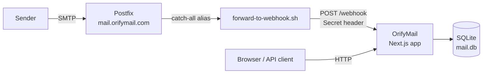

<div align="center">

# OrifyMail

**Fast, private, open-source disposable email.**

Create a temporary inbox in one click. No sign-up, no tracking, and messages delete themselves after 3 days.

[**Website**](https://orifymail.com) · [**API Docs**](https://orifymail.com/api) · [**Report a Bug**](https://github.com/lettaidev/temp_mail_v2/issues)


</div>

---

## Table of Contents

- [Overview](#overview)
- [Features](#features)
- [How It Works](#how-it-works)
- [Tech Stack](#tech-stack)
- [Quick Start](#quick-start)
- [Configuration](#configuration)
- [Production Deployment](#production-deployment)
- [Docker](#docker)
- [REST API](#rest-api)
- [Project Structure](#project-structure)
- [Contributing](#contributing)
- [Support](#support)
- [License](#license)

---

## Overview

OrifyMail is a self-hostable temporary email service. It gives every visitor a random address on your domain (e.g. `orbit-lemon@orifymail.com`). Any mail sent to that address shows up in the browser within seconds.

It is a good fit for:

- Signing up for services without exposing your real address
- Testing transactional email flows during development and QA
- Avoiding spam and marketing lists

## Features

| | |
|---|---|
| **Instant inboxes** | Random, human-readable addresses generated on page load; custom names supported |
| **Catch-all delivery** | Every address on the domain works, no registration needed |
| **Auto refresh** | The inbox polls for new messages automatically |
| **HTML & text rendering** | Email bodies are displayed in HTML or plain text |
| **Auto-expiry** | Messages expire after 3 days; a background job removes them every 2 hours |
| **Manual delete** | Users can remove a message at any time |
| **Public REST API** | JSON endpoints for automation and testing, no API key required |
| **Lightweight** | Single Next.js process with an embedded SQLite database |

## How It Works



1. Postfix accepts mail for every address on the domain and routes it to a single catch-all alias.
2. The alias pipes the raw message to a shell script, which removes attachments and POSTs it to `/webhook`.
3. The app checks the `Secret` header, parses the message with `mailparser`, and stores it in SQLite.
4. Users read their inbox in the web UI or through the REST API.

## Tech Stack

- **Framework:** [Next.js 15](https://nextjs.org) (App Router, Turbopack) + React 19
- **Language:** TypeScript
- **Styling:** Tailwind CSS, shadcn/ui, Lucide icons
- **Database:** SQLite via `better-sqlite3`
- **Email parsing:** `mailparser`
- **Validation:** Zod, `@t3-oss/env-nextjs`
- **Mail server:** Postfix (catch-all, forwards to a webhook)

## Quick Start

### Prerequisites

- Node.js 20+
- npm (or Bun)

### Run locally

```bash
git clone https://github.com/lettaidev/temp_mail_v2.git orifymail
cd orifymail

npm install --force

# Shared secret that the mail forwarder must send to /webhook
export SECRET="change-me"

npm run dev
```

Open http://localhost:9169.

### Send a test email to the webhook

You can test the app without a mail server by posting a raw message straight to the webhook:

```bash
cat <<'EOF' | curl -X POST -H "Content-Type: text/plain" -H "Secret: change-me" \
  --data-binary @- http://localhost:9169/webhook
From: sender@example.com
To: demo@orifymail.com
Subject: Hello from OrifyMail

This is a test message.
EOF
```

Then open http://localhost:9169/demo@orifymail.com.

### Scripts

| Command | Description |
|---|---|
| `npm run dev` | Start the development server on port `9169` |
| `npm run build` | Create a production build |
| `npm run start` | Serve the production build on port `9169` |
| `npm run lint` | Run ESLint |
| `npm run format` | Format the source with Prettier |

## Configuration

### Environment variables

| Variable | Required | Description |
|---|---|---|
| `SECRET` | Yes | Shared secret checked against the `Secret` header on `POST /webhook` |

### Brand & domain

The site name, public URL, and email domain are defined in one place, [`src/lib/site-config.ts`](src/lib/site-config.ts):

```ts
export const SITE_NAME = "OrifyMail";
export const SITE_URL = "https://orifymail.com";
export const EMAIL_DOMAIN = "orifymail.com";
```

Change these values to run the service on your own domain.

## Production Deployment

The steps below assume **Ubuntu**, **Cloudflare DNS**, and the domain `orifymail.com`. Replace `orifymail.com` with your own domain everywhere.

### 1. DNS records

In your DNS provider, add:

| Type | Name | Value | Notes |
|---|---|---|---|
| `A` | `mail` | `<your VPS IP>` | **DNS only** (proxy off) in Cloudflare |
| `MX` | `@` | `mail.orifymail.com` | Priority `10` |
| `TXT` | `@` | `v=spf1 mx ~all` | SPF |

Point the web app record (for example `@` or `www`) to the server or reverse proxy that runs the Next.js app.

> Make sure outbound and inbound port **25** is open at your VPS provider. Many providers block it by default.

### 2. Prepare the server

```bash
sudo apt update && sudo apt upgrade -y
sudo hostnamectl set-hostname mail.orifymail.com
echo "<your VPS IP> mail.orifymail.com orifymail.com" | sudo tee -a /etc/hosts
```

### 3. Install and configure Postfix

```bash
sudo apt install postfix -y
```

When prompted, choose **Internet Site** and enter `orifymail.com` as the system mail name.

Edit `/etc/postfix/main.cf` and add or update these lines:

```ini
myhostname = mail.orifymail.com
mydestination = $myhostname, orifymail.com, localhost.$mydomain, localhost
inet_interfaces = all
mynetworks = 127.0.0.0/8 [::ffff:127.0.0.0]/104 [::1]/128
smtpd_recipient_restrictions = permit_mynetworks, reject_unauth_destination
virtual_alias_domains = orifymail.com
virtual_alias_maps = regexp:/etc/postfix/virtual_regexp
```

Create `/etc/postfix/virtual_regexp` to route every address to a single catch-all:

```
/.+@orifymail\.com/ catchall@orifymail.com
```

### 4. Forward incoming mail to the webhook

Create `/usr/local/bin/forward-to-webhook.sh`:

```bash
#!/bin/bash
# Strip attachments and inline parts, then send the raw message to OrifyMail
sed '/Content-Disposition: attachment/,/^\s*$/d; /Content-Disposition: inline/,/^\s*$/d' | \
curl -X POST -H "Content-Type: text/plain" -H "Secret: <your SECRET>" \
  --data-binary @- http://localhost:9169/webhook
```

> `<your SECRET>` must match the app's `SECRET` environment variable. Change the URL if the app runs on another host or port.

Make it executable, register the alias, and restart Postfix:

```bash
sudo chmod +x /usr/local/bin/forward-to-webhook.sh
echo 'catchall: "|/usr/local/bin/forward-to-webhook.sh"' | sudo tee -a /etc/aliases
sudo newaliases
sudo systemctl restart postfix
```

### 5. Run the application

```bash
git clone https://github.com/lettaidev/temp_mail_v2.git orifymail
cd orifymail
npm install --force
npm run build
SECRET="<your SECRET>" npm run start
```

For production, run the app under a process manager (systemd, PM2, or Docker) and put a reverse proxy with HTTPS (Nginx, Caddy, or Cloudflare) in front of port `9169`.

## Docker

A `Dockerfile` is included for the web application. Postfix still runs on the host.

```bash
docker build -t orifymail .
docker run -d --name orifymail \
  -p 9169:9169 \
  -e SECRET="<your SECRET>" \
  orifymail
```

> The SQLite database (`mail.db`) is created in the container's working directory. Mount a volume if messages must survive container restarts.

## REST API

The API is public, needs no API key, and returns JSON. Full interactive docs: **https://orifymail.com/api**

| Method | Endpoint | Description |
|---|---|---|
| `GET` | `/api/email/{address}` | List messages received by an address |
| `GET` | `/api/inbox/{inboxId}` | Get one message, including text and HTML body |
| `GET` | `/api/delete/{inboxId}` | Delete a message |

**Example**

```bash
curl https://orifymail.com/api/email/recipient@orifymail.com
```

```json
[
  {
    "id": "cm3sqher40005276o336z4fvw",
    "subject": "Test Email",
    "createdAt": 1732279492000,
    "expiresAt": 1732538692335,
    "fromAddress": "sender@example.com",
    "toAddress": "recipient@orifymail.com"
  }
]
```

## Project Structure

```
src/
├── app/
│   ├── [email]/            # Inbox view for an address
│   ├── inbox/[inboxId]/    # Single message view
│   ├── delete/[inboxId]/   # Delete confirmation and redirect
│   ├── api/                # REST API routes and API docs page
│   ├── webhook/            # Ingest endpoint called by Postfix
│   └── layout.tsx          # App shell, header, footer, metadata
├── components/             # UI and client components
├── database/               # SQLite connection, schema, queries
├── lib/                    # Site config, random address generator, helpers
└── utils/                  # Email parsing and Zod schemas
```

## Contributing

Contributions are welcome.

1. Fork the repository
2. Create a feature branch: `git checkout -b feat/my-feature`
3. Commit with [Conventional Commits](https://www.conventionalcommits.org): `git commit -m "feat: add my feature"`
4. Push and open a pull request

Please run `npm run lint` and `npm run format` before you submit.

## Support

- Website: [orifymail.com](https://orifymail.com)
- Telegram: [@Lethanhtai](https://t.me/Lethanhtai)
- Issues: [GitHub Issues](https://github.com/lettaidev/temp_mail_v2/issues)

## License

Released under the [MIT License](LICENSE). © 2024 OrifyMail.
